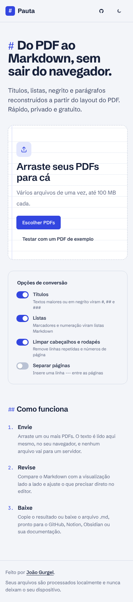
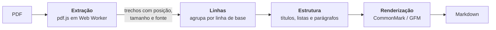

<div align="center">

# Pauta

**Converta PDFs em Markdown limpo, direto no navegador.**

Títulos, listas, negrito e parágrafos reconstruídos a partir do layout do PDF, sem enviar o arquivo a nenhum servidor.

[](https://github.com/joaopedrogurgel/markDOWN/actions/workflows/deploy.yml)
[](LICENSE)

[**Abrir a demo**](https://joaopedrogurgel.github.io/markDOWN/) · [Como funciona](#como-funciona) · [Rodar localmente](#rodando-localmente)

</div>

<br />

<p align="center">
  
</p>

## Sobre o projeto

Ferramentas como o [markitdown](https://github.com/microsoft/markitdown), da Microsoft, convertem documentos em Markdown pela linha de comando. A Pauta leva essa ideia para uma interface web: você arrasta o PDF, revisa o resultado ao lado da visualização, ajusta o que precisar e baixa o `.md`.

A conversão roda inteira no navegador. Isso traz três vantagens: privacidade (o arquivo nunca sai do dispositivo), custo zero de infraestrutura e nenhuma espera por um servidor acordar.

## Funcionalidades

- **Upload sem atrito:** arraste vários PDFs em qualquer lugar da página. Eles entram numa fila com progresso por página.
- **Estrutura reconstruída:**
  - títulos pelo tamanho da fonte (`#`, `##`, `###`) e por linhas curtas em negrito
  - listas com marcadores e numeradas, inclusive aninhadas
  - `**negrito**` no meio das frases
  - parágrafos quebrados em várias linhas voltam a ser um só, e palavras hifenizadas no fim da linha são reconstruídas
- **Limpeza automática:** cabeçalhos, rodapés e números de página repetidos são removidos.
- **Editor com visualização:** Markdown e resultado renderizado lado a lado, com opção de descartar as edições.
- **Opções em tempo real:** ligar ou desligar títulos, listas, limpeza e separação de páginas reconverte o documento na hora.
- **Exportação:** copiar para a área de transferência ou baixar o `.md`.
- **Experiência cuidada:** tema claro e escuro, layout responsivo, navegação por teclado e respeito à preferência de reduzir animações.

<p align="center">
  
  &nbsp;
  
</p>

## Como funciona

O PDF não guarda parágrafos nem títulos, só trechos de texto posicionados na página. A conversão reconstrói essa estrutura em quatro etapas:



| Etapa        | Arquivo                                                  | O que faz                                                                                                                        |
| ------------ | -------------------------------------------------------- | -------------------------------------------------------------------------------------------------------------------------------- |
| Extração     | [`pdf/extract.ts`](src/lib/pdf/extract.ts)               | Lê cada página com o pdf.js e devolve os trechos de texto com coordenadas, tamanho e peso da fonte.                              |
| Linhas       | [`markdown/layout.ts`](src/lib/markdown/layout.ts)       | Junta trechos que dividem a mesma linha de base e infere espaços pela distância entre eles.                                      |
| Estrutura    | [`markdown/structure.ts`](src/lib/markdown/structure.ts) | Usa o tamanho de fonte mais frequente como corpo do texto. Tamanhos maiores viram títulos, e o espaçamento define os parágrafos. |
| Renderização | [`markdown/render.ts`](src/lib/markdown/render.ts)       | Serializa os blocos em Markdown e escapa caracteres que criariam blocos sem querer.                                              |

## Decisões técnicas

**Processamento no cliente em vez de backend.** Um serviço em Python com o markitdown seria o caminho óbvio, mas exigiria hospedar e manter um servidor e receber arquivos de terceiros. Fazendo tudo no navegador, o site é estático, pode ser hospedado de graça e não lida com dados de ninguém.

**Funções puras separadas da interface.** Só a extração depende do pdf.js. As outras etapas são funções síncronas que recebem dados e devolvem texto. Por isso são fáceis de testar e, quando o usuário muda uma opção, o Markdown é regerado a partir das páginas já extraídas, sem ler o PDF de novo.

**Carregamento sob demanda.** O pdf.js (cerca de 1 MB) e o renderizador de Markdown só são baixados quando o primeiro arquivo chega. A página inicial carrega rápido.

**Segurança.** O conteúdo do PDF é tratado como não confiável: a visualização ignora HTML bruto, os links abrem com `rel="noopener"` e o arquivo é validado pela assinatura `%PDF` antes de ser processado.

**Estado previsível.** A fila de arquivos é controlada por um `useReducer` e os PDFs são convertidos um por vez, o que mantém o uso de memória estável. Remover um arquivo no meio da leitura cancela a conversão com `AbortController`.

## Stack

| Camada    | Tecnologia                                                          |
| --------- | ------------------------------------------------------------------- |
| Interface | React 19, TypeScript em modo estrito, CSS Modules com design tokens |
| Build     | Vite                                                                |
| Leitura   | [pdf.js](https://mozilla.github.io/pdf.js/) em Web Worker           |
| Preview   | react-markdown + remark-gfm                                         |
| Qualidade | Vitest, oxlint, Prettier                                            |
| CI/CD     | GitHub Actions → GitHub Pages                                       |

## Estrutura de pastas

```
src/
├── components/        # Interface: upload, lista de arquivos, editor, preview
├── hooks/             # Fila de conversão, tema, drag and drop, media queries
├── lib/
│   ├── markdown/      # Pipeline puro: linhas → blocos → Markdown (+ testes)
│   └── pdf/           # Extração de texto com pdf.js
├── styles/            # Tokens de design e estilos globais
└── config.ts          # Links do autor e do repositório
```

## Rodando localmente

Requer Node.js 20.19 ou superior.

```bash
git clone https://github.com/joaopedrogurgel/markDOWN.git
cd markDOWN
npm install
npm run dev
```

Abra http://localhost:5173.

| Comando           | O que faz                                                |
| ----------------- | -------------------------------------------------------- |
| `npm run dev`     | Servidor de desenvolvimento                              |
| `npm test`        | Testes unitários e de integração                         |
| `npm run check`   | Tipos, lint, formatação e testes (o mesmo que o CI roda) |
| `npm run build`   | Build de produção em `dist/`                             |
| `npm run preview` | Serve o build localmente                                 |

## Testes

As regras de conversão têm testes unitários com páginas sintéticas: junção de parágrafos, hifenização, níveis de título, listas aninhadas, remoção de cabeçalhos e rodapés, continuação entre páginas e opções desligadas. Um teste de integração converte o [PDF de exemplo](public/exemplo.pdf) de ponta a ponta com o pdf.js e confere o Markdown resultante.

## Deploy

O workflow [`deploy.yml`](.github/workflows/deploy.yml) roda `npm run check` em todo push e pull request, e publica a branch `main` no GitHub Pages.

Para ativar num fork, vá em **Settings → Pages** e em **Source** escolha **GitHub Actions**. O caminho base do site é definido automaticamente a partir do nome do repositório.

O projeto também funciona na Vercel ou na Netlify sem configuração extra: comando `npm run build`, pasta `dist`.

## Limitações e próximos passos

- [ ] Reconhecer tabelas simples e convertê-las em tabelas GFM
- [ ] Ler layouts em várias colunas na ordem certa
- [ ] OCR no navegador (Tesseract.js) para PDFs escaneados
- [ ] Baixar todos os arquivos convertidos em um `.zip`

## Autor

Feito por **João Gurgel**, estudante de Engenharia de Software na UEM.

[GitHub](https://github.com/joaopedrogurgel)

## Licença

Distribuído sob a licença [MIT](LICENSE).
