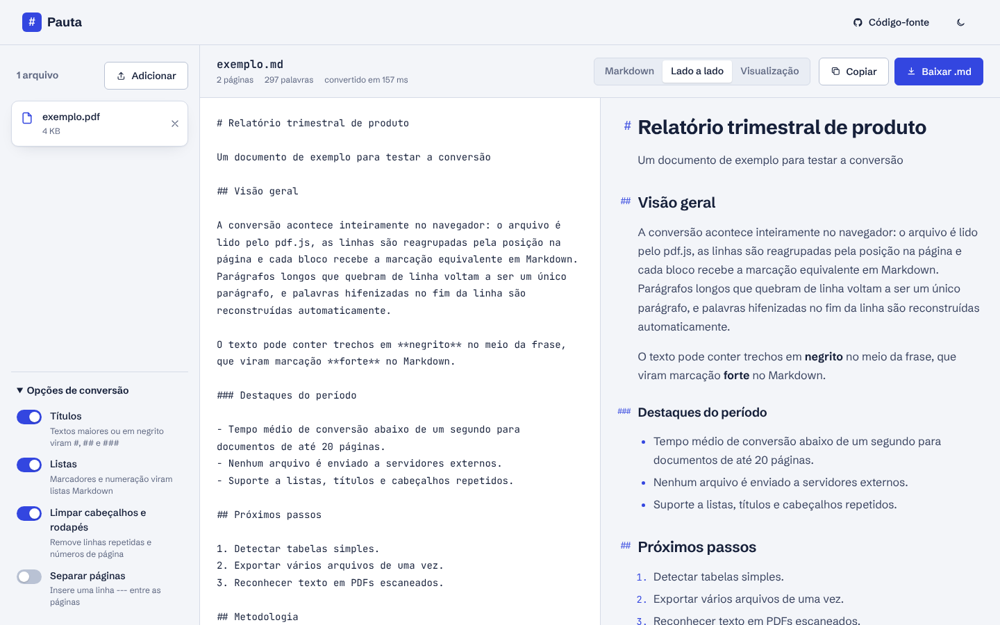

# Pauta — PDF para Markdown no navegador

Converta PDFs em Markdown limpo, com títulos, listas, negrito e parágrafos reconstruídos a partir do layout do documento. Toda a conversão acontece no navegador: nenhum arquivo é enviado a servidor.

**Demo:** _adicione aqui o link depois do deploy_



## Funcionalidades

- Arrastar e soltar vários PDFs em qualquer lugar da página, com fila de conversão e progresso por página
- Títulos detectados pelo tamanho da fonte (`#`, `##`, `###`) e por linhas curtas em negrito
- Listas com marcadores e numeradas, inclusive aninhadas
- Trechos em negrito no meio da frase viram `**negrito**`
- Parágrafos quebrados em várias linhas são unidos, e palavras hifenizadas no fim da linha são reconstruídas
- Cabeçalhos, rodapés e números de página repetidos são removidos
- Editor de Markdown com visualização lado a lado; as edições podem ser descartadas a qualquer momento
- Copiar para a área de transferência e baixar o `.md`
- Tema claro e escuro, layout responsivo e navegação por teclado

## Stack

| Camada    | Escolha                                                   |
| --------- | --------------------------------------------------------- |
| Interface | React 19 + TypeScript, CSS Modules com design tokens      |
| Build     | Vite                                                      |
| Leitura   | [pdf.js](https://mozilla.github.io/pdf.js/) em Web Worker |
| Preview   | react-markdown + remark-gfm (HTML bruto é ignorado)       |
| Qualidade | Vitest, oxlint, Prettier, `tsc` em modo estrito           |
| CI/Deploy | GitHub Actions → GitHub Pages                             |

## Como funciona a conversão

O pipeline fica em [`src/lib`](src/lib) e é dividido em etapas puras e testáveis:

1. **Extração** ([`pdf/extract.ts`](src/lib/pdf/extract.ts)): o pdf.js devolve cada trecho de texto com posição, tamanho e fonte. O peso (negrito) vem do nome da fonte embutida. O pdf.js só é baixado quando o primeiro arquivo chega.
2. **Linhas** ([`markdown/layout.ts`](src/lib/markdown/layout.ts)): trechos com a mesma linha de base viram uma linha visual, com espaços inferidos pela distância entre eles.
3. **Estrutura** ([`markdown/structure.ts`](src/lib/markdown/structure.ts)): o tamanho de fonte mais frequente é o corpo do texto; tamanhos maiores viram níveis de título. O espaçamento vertical decide o que é continuação de parágrafo, e a indentação define o aninhamento das listas.
4. **Renderização** ([`markdown/render.ts`](src/lib/markdown/render.ts)): os blocos são serializados em CommonMark/GFM.

Como as etapas 2 a 4 são síncronas e não dependem do navegador, mudar uma opção reconverte o documento instantaneamente, sem ler o PDF de novo.

## Rodando localmente

Requer Node.js 20.19 ou superior.

```bash
npm install
npm run dev        # http://localhost:5173
```

Outros comandos:

```bash
npm test           # testes unitários e de integração com o PDF de exemplo
npm run check      # typecheck + lint + formatação + testes
npm run build      # gera a versão de produção em dist/
npm run preview    # serve o build localmente
```

## Deploy

### GitHub Pages (já configurado)

1. Crie um repositório no GitHub e envie o projeto para a branch `main`.
2. No repositório, vá em **Settings → Pages** e em **Source** escolha **GitHub Actions**.
3. O workflow [`.github/workflows/deploy.yml`](.github/workflows/deploy.yml) roda os testes e publica em `https://<seu-usuario>.github.io/<repositorio>/` a cada push na `main`.

### Vercel ou Netlify

Importe o repositório e use as configurações detectadas automaticamente para Vite: comando `npm run build`, pasta `dist`. Não é preciso definir `BASE_PATH`.

Antes de publicar, ajuste os seus links em [`src/config.ts`](src/config.ts).

## Limitações

- PDFs escaneados (só imagem) não têm camada de texto. É preciso passar por um OCR antes.
- Layouts em várias colunas e tabelas são lidos como texto corrido.

## Licença

MIT
