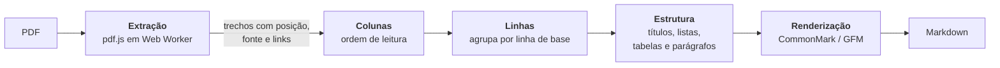

<div align="center">

# markDOWN

**Converta PDFs em Markdown limpo, direto no navegador.**

Títulos, listas, tabelas, links e textos em duas colunas reconstruídos a partir do layout do PDF, sem enviar o arquivo a nenhum servidor. Funciona até sem internet.

[](https://github.com/joaopedrogurgel/markDOWN/actions/workflows/deploy.yml)
[](LICENSE)

[**Abrir a demo**](https://joaopedrogurgel.github.io/markDOWN/) · [Como funciona](#como-funciona) · [Qualidade](#qualidade-medida) · [Rodar localmente](#rodando-localmente)

</div>

<br />

<p align="center">
  
</p>

## Sobre o projeto

Ferramentas como o [markitdown](https://github.com/microsoft/markitdown), da Microsoft, convertem documentos em Markdown pela linha de comando. O markDOWN leva essa ideia para uma interface web: você arrasta o PDF, revisa o resultado ao lado da visualização, ajusta o que precisar e baixa o `.md`.

A conversão roda inteira no navegador. Isso traz três vantagens: privacidade (o arquivo nunca sai do dispositivo), custo zero de infraestrutura e nenhuma espera por um servidor.

## Funcionalidades

- **Estrutura reconstruída:**
  - títulos pelo tamanho da fonte (`#`, `##`, `###`) e por linhas curtas em negrito
  - listas com marcadores e numeradas, inclusive aninhadas
  - **tabelas** alinhadas em grade viram tabelas GFM
  - páginas em **duas colunas** são lidas na ordem certa, com títulos e resumos de largura inteira no lugar
  - `**negrito**`, `*itálico*` e `[links](https://…)` preservados dentro das frases
  - parágrafos quebrados em várias linhas voltam a ser um só, e palavras hifenizadas são reconstruídas
- **Limpeza automática:** cabeçalhos, rodapés e números de página repetidos são removidos.
- **Editor com destaque de sintaxe** (CodeMirror 6) e visualização lado a lado, com rolagem sincronizada.
- **Vários arquivos:** fila com progresso por página e download de todos em um `.zip`.
- **Histórico local:** os arquivos convertidos voltam na próxima visita, salvos só no aparelho. Dá para desligar e limpar.
- **Funciona offline** e pode ser instalado como app (PWA).
- **Opções em tempo real:** mudar uma opção reconverte o documento na hora, sem ler o PDF de novo.
- **Experiência cuidada:** tema claro e escuro, layout responsivo, navegação por teclado e respeito à preferência de reduzir animações.

<p align="center">
  
  &nbsp;
  
</p>

## Como funciona

O PDF não guarda parágrafos, colunas nem tabelas, só trechos de texto posicionados na página. A conversão reconstrói essa estrutura em etapas:



| Etapa        | Arquivo                                                                                                      | O que faz                                                                                                                                                                               |
| ------------ | ------------------------------------------------------------------------------------------------------------ | --------------------------------------------------------------------------------------------------------------------------------------------------------------------------------------- |
| Extração     | [`pdf/extract.ts`](src/lib/pdf/extract.ts), [`pdf/runs.ts`](src/lib/pdf/runs.ts)                             | Lê cada página com o pdf.js. Negrito e itálico vêm do nome da fonte; links, das anotações da página, cortando o trecho exatamente na borda do link.                                     |
| Colunas      | [`markdown/columns.ts`](src/lib/markdown/columns.ts)                                                         | Procura a calha entre colunas contando quantas linhas cobrem cada faixa vertical. Só divide quando um dos lados é claramente prosa, para não confundir uma tabela com colunas de texto. |
| Linhas       | [`markdown/layout.ts`](src/lib/markdown/layout.ts)                                                           | Junta os trechos que dividem a mesma linha de base e infere os espaços pela distância entre eles.                                                                                       |
| Estrutura    | [`markdown/structure.ts`](src/lib/markdown/structure.ts), [`markdown/tables.ts`](src/lib/markdown/tables.ts) | Define títulos pelo tamanho da fonte, parágrafos pelo espaçamento ou recuo, e tabelas por corredores verticais vazios que atravessam várias linhas seguidas.                            |
| Renderização | [`markdown/render.ts`](src/lib/markdown/render.ts), [`markdown/spans.ts`](src/lib/markdown/spans.ts)         | Serializa os blocos em Markdown, com estilos por trecho e escape de caracteres que criariam formatação sem querer.                                                                      |

## Decisões técnicas

**Processamento no cliente em vez de backend.** Um serviço em Python com o markitdown seria o caminho óbvio, mas exigiria manter um servidor e receber arquivos de terceiros. Fazendo tudo no navegador, o site é estático, hospedado de graça, e não lida com dados de ninguém.

**Qualidade medida, não estimada.** Heurísticas de layout quebram fácil: uma regra que ajuda um documento pode estragar outro. Por isso existe um [corpus](corpus/) de PDFs gerados por quatro ferramentas diferentes, cada um com o Markdown esperado escrito à mão. O CI calcula a nota de semelhança de cada documento e falha se qualquer um ficar abaixo da sua linha de base.

**Tabelas por alinhamento vertical, não por espaçamento.** No texto justificado do LaTeX, o espaço entre duas palavras pode ser tão largo quanto o espaço entre colunas de uma tabela. O que diferencia uma tabela é um corredor vazio que atravessa várias linhas seguidas no mesmo lugar. O corpus mostrou isso antes de qualquer usuário.

**Funções puras separadas da interface.** Só a extração depende do pdf.js. As outras etapas recebem dados e devolvem texto, então são fáceis de testar e, quando o usuário muda uma opção, o Markdown é regerado a partir das páginas já extraídas.

**Peso controlado.** A página inicial carrega 89 KB (gzip); o CI falha acima de 100 KB. O leitor de PDF, o editor, a visualização, o gerador de `.zip` e o armazenamento local são baixados só quando usados. O editor monta a linguagem Markdown direto do parser Lezer, porque o pacote pronto do CodeMirror traria junto os parsers de HTML, CSS e JavaScript (177 KB contra 102 KB).

**Offline sem dependências.** Um plugin do Vite de menos de 80 linhas ([`vite-plugin-offline.ts`](scripts/vite-plugin-offline.ts)) gera o service worker com a lista exata de arquivos do build. Os arquivos com hash vêm do cache; a página vem da rede primeiro, para que um deploy novo apareça assim que houver conexão.

**Privacidade por padrão.** O conteúdo do PDF é tratado como não confiável: a visualização ignora HTML bruto, links só aceitam `http`, `https` e `mailto`, e o arquivo é validado pela assinatura `%PDF`. O monitoramento de erros e as métricas de uso são opcionais, desligados se não forem configurados, e nunca enviam nome ou conteúdo de documentos.

## Qualidade medida

Nota de semelhança (0 a 1) entre o Markdown gerado e o esperado, por documento do corpus:

| Documento                 | Gerado por  | Desafio                              | v1.0      | v2.0      |
| ------------------------- | ----------- | ------------------------------------ | --------- | --------- |
| `artigo-duas-colunas.pdf` | Chrome      | duas colunas, links, itálico         | 0,426     | 1,000     |
| `artigo-latex.pdf`        | pdfLaTeX    | duas colunas, hifenização, tabela    | 0,569     | 0,993     |
| `relatorio-tabela.pdf`    | Chrome      | tabela com números, listas, link     | 0,867     | 0,995     |
| `memorando.pdf`           | LibreOffice | tabela com bordas, marcadores em tab | 0,924     | 1,000     |
| `exemplo-reportlab.pdf`   | ReportLab   | títulos, listas, cabeçalho e rodapé  | 0,999     | 1,000     |
| **Média**                 |             |                                      | **0,757** | **0,998** |

`npm run corpus` imprime a tabela atual e salva as saídas em `corpus/.out/` para comparação.

## Stack

| Camada        | Tecnologia                                                          |
| ------------- | ------------------------------------------------------------------- |
| Interface     | React 19, TypeScript em modo estrito, CSS Modules com design tokens |
| Build         | Vite, com plugin próprio para o service worker                      |
| Leitura       | [pdf.js](https://mozilla.github.io/pdf.js/) em Web Worker           |
| Editor        | CodeMirror 6 + Lezer Markdown                                       |
| Preview       | react-markdown + remark-gfm                                         |
| Armazenamento | IndexedDB (idb-keyval) e localStorage                               |
| Qualidade     | Vitest, Playwright, oxlint, Prettier, corpus com nota de semelhança |
| CI/CD         | GitHub Actions → GitHub Pages, Dependabot                           |

## Estrutura de pastas

```
corpus/                # PDFs de teste, Markdown esperado e linha de base das notas
  sources/             # HTML e LaTeX que geram os PDFs (scripts/build_corpus.py)
e2e/                   # Testes no navegador (Playwright), desktop e celular
scripts/               # Plugin offline, limite de tamanho, geração do corpus
src/
├── components/        # Interface: upload, lista de arquivos, editor, preview
├── hooks/             # Fila de conversão, histórico, tema, drag and drop
├── lib/
│   ├── markdown/      # Pipeline puro: colunas → linhas → blocos → Markdown
│   ├── pdf/           # Extração de texto, estilos e links com pdf.js
│   ├── storage.ts     # Opções e histórico no navegador
│   └── telemetry.ts   # Erros e métricas anônimas, opcionais
└── styles/            # Tokens de design e estilos globais
```

## Rodando localmente

Requer Node.js 20.19 ou superior.

```bash
git clone https://github.com/joaopedrogurgel/markDOWN.git
cd markDOWN
npm install
npm run dev
```

Abra http://localhost:5173.

| Comando                 | O que faz                                                              |
| ----------------------- | ---------------------------------------------------------------------- |
| `npm run dev`           | Servidor de desenvolvimento                                            |
| `npm test`              | Testes unitários, de integração e do corpus                            |
| `npm run test:e2e`      | Testes no navegador (instale antes: `npx playwright install chromium`) |
| `npm run check`         | Tipos, lint, formatação e testes (o mesmo que o CI roda)               |
| `npm run corpus`        | Nota de cada documento do corpus                                       |
| `npm run corpus:update` | Grava as notas atuais como nova linha de base                          |
| `npm run build`         | Build de produção em `dist/`                                           |
| `npm run size`          | Confere o limite de 100 KB da página inicial                           |

Para adicionar um documento ao corpus, coloque o `.pdf` e o `.md` esperado com o mesmo nome em `corpus/` e rode `npm run corpus:update`.

## Deploy

O workflow [`deploy.yml`](.github/workflows/deploy.yml) roda tipos, lint, testes, corpus e testes no navegador em todo push e pull request. Na branch `main`, também confere o limite de tamanho e publica no GitHub Pages.

Para ativar num fork, vá em **Settings → Pages** e em **Source** escolha **GitHub Actions**. O caminho base do site é definido a partir do nome do repositório.

**Telemetria (opcional).** Em **Settings → Secrets and variables → Actions → Variables**, crie `SENTRY_DSN` para receber erros no [Sentry](https://sentry.io) e `GOATCOUNTER_URL` (por exemplo, `https://seu-site.goatcounter.com/count`) para contar eventos anônimos no [GoatCounter](https://www.goatcounter.com). Sem essas variáveis, nada é enviado.

## Limitações e próximos passos

- [ ] OCR no navegador (Tesseract.js) para PDFs escaneados
- [ ] Arquivos Word (`.docx`)
- [ ] Marcadores de lista desenhados como forma, e não como texto (o Chrome faz isso), ainda não são reconhecidos
- [ ] Bloco de título do LaTeX: autor e data saem como subtítulos
- [ ] Tabelas com células mescladas ou sem alinhamento em grade
- [ ] Ampliar o corpus com PDFs reais de terceiros

Veja as mudanças de cada versão no [CHANGELOG](CHANGELOG.md).

## Autor

Feito por **João Gurgel**, estudante de Engenharia de Software na UEM.

[GitHub](https://github.com/joaopedrogurgel)

## Licença

Distribuído sob a licença [MIT](LICENSE).
